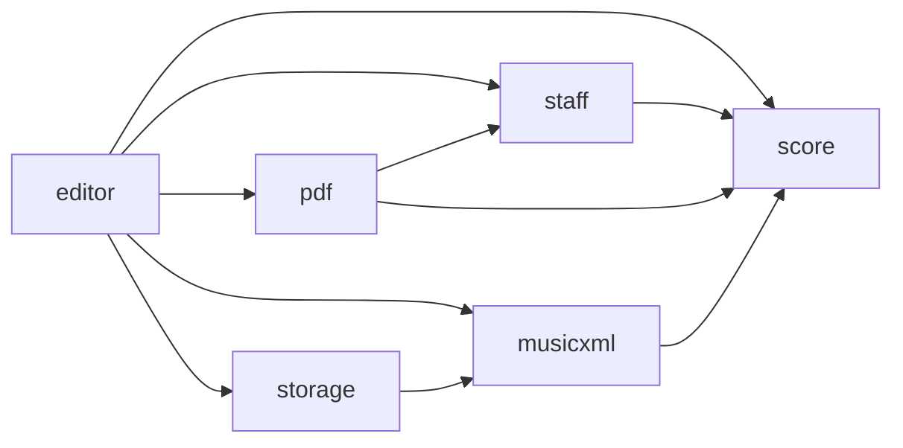

> Generated by /vibe:docs — manual edits will be overwritten; use README for hand-written content.

# Architecture

Le site est statique : tout s'exécute dans le navigateur, sans backend. Le point d'entrée `src/main.ts` monte l'éditeur dans `#app` et le redessine quand la fenêtre est redimensionnée.

## Modules

| Module | Rôle |
|---|---|
| `src/score.ts` | Modèle pur de la partition : notes, silences, réglages (clé, armure, chiffrage), mesures. Aucune dépendance au DOM ni à VexFlow. |
| `src/staff.ts` | Rendu SVG des portées avec VexFlow ; renvoie la géométrie utile aux clics. |
| `src/editor.ts` | Interface : réglages, palette, clics, clavier, boutons d'import et d'export, annonces. |
| `src/musicxml.ts` | Conversion de la partition vers MusicXML 4.0 et lecture d'un fichier MusicXML. |
| `src/pdf.ts` | PDF A4 vectoriel avec svg2pdf.js et jsPDF ; police musicale embarquée (`src/fonts/`). |
| `src/storage.ts` | Sauvegarde et relecture dans un `Storage` injecté, au format MusicXML. |

## Flux de données

L'éditeur détient l'état. Chaque modification passe par les fonctions pures de `score.ts`, puis l'éditeur redessine la portée via `staff.ts` et enregistre via `storage.ts`. L'export PDF réutilise le rendu SVG de `staff.ts`. La sauvegarde dans le navigateur réutilise le format MusicXML, donc l'import, l'export et la restauration partagent la même lecture.

## Choix techniques

Les décisions sont dans `.vibe/decisions/` : VexFlow pour le rendu (001), svg2pdf.js avec jsPDF pour le PDF vectoriel (001, 003).
